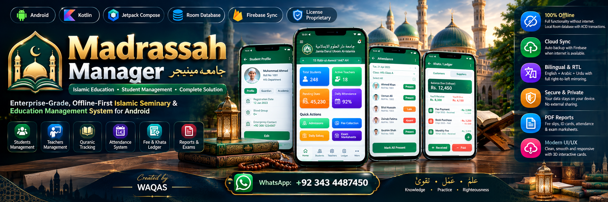

<p align="center">
  
</p>

# 🕌 Madrassah Manager (جامعہ مینیجر)
### *Enterprise-Grade, Offline-First Islamic Seminary & Education Management System for Android*

<p align="center">
  <a href="https://developer.android.com"></a>
  <a href="https://kotlinlang.org"></a>
  <a href="https://developer.android.com/jetpack/compose"></a>
  <a href="https://developer.android.com/training/data-storage/room"></a>
  <a href="https://firebase.google.com"></a>
  <a href="https://wa.me/92343487450"></a>
  <a href="#-developer--brand-information"></a>
</p>

---

## 👨‍💻 Developer & Brand Information

| Attribute | Details |
| :--- | :--- |
| **Lead Architect & Developer** | **Waqas** |
| **Software House** | **Waqas Software House** |
| **Direct Contact / WhatsApp** | [**+92 343 4487450**](https://wa.me/92343487450) (`tel:+92343487450`) |
| **Category** | Islamic Educational Technology & Seminary ERP |
| **Architecture** | 100% Offline-First SQLite (Room) + Optional Centralized Firebase Cloud Sync |
| **Design System** | Material Design 3 (M3) Emerald Jade & Islamic Gold Palette with 3D Depth |
| **License & Commercial Use** | Commercial Ready & Proprietary by **Waqas Software House** |

---

## 📖 Table of Contents
- [✨ Key Features](#-key-features)
- [🏷️ Full Customization & Editing Madrassah Full Name](#️-full-customization--editing-madrassah-full-name)
- [🏛️ System Architecture](#️-system-architecture)
- [📱 Complete Mobile Installation Guide (APK Sideloading)](#-complete-mobile-installation-guide-apk-sideloading)
- [💻 Developer Setup & Android Studio Build](#-developer-setup--android-studio-build)
- [🚀 Google Play Store Release & Deployment Guide](#-google-play-store-release--deployment-guide)
  - [1. Generate Production Release Keystore](#1-generate-production-release-keystore)
  - [2. Configure Build Environment & Signing](#2-configure-build-environment--signing)
  - [3. Build Production Android App Bundle (.aab)](#3-build-production-android-app-bundle-aab)
  - [4. Store Listing Assets & Metadata Checklist](#4-store-listing-assets--metadata-checklist)
  - [5. Play Console Submission & Review](#5-play-console-submission--review)
- [🔒 Permissions & Google Play Policy Compliance](#-permissions--google-play-policy-compliance)
- [🌐 Bilingual & RTL Localization](#-bilingual--rtl-localization)
- [❓ Troubleshooting & FAQ](#-troubleshooting--faq)
- [📞 Inquiries & Custom Implementations](#-inquiries--custom-implementations)

---

## ✨ Key Features

### 1. 🎛️ Executive Dashboard & 3D Interactive Cards
- **3D Animated Counter Cards**: Real-time metrics for Total Students, Active Faculty (Asatiza), Pending Dues, and Daily Attendance percentages with depth elevation and dynamic gloss accents.
- **Madrassah Emblem Header**: Displays institutional branding in English and Arabic (`Jamia Darul Uloom Al-Islamia`) alongside Hijri Islamic Calendar dates (`15 Rabi-ul-Awwal 1447 AH`).
- **Quick Action Grid**: Instant shortcuts for Admissions, Fee Collection, Daily Sabaq, and Exam Marksheets.

### 2. 👨‍🎓 Comprehensive Student & Teacher Directory
- **Deep Profiles**: Full biodata including Roll Number, Registration Date, Guardian Information, Emergency Contacts, Blood Group, and Current Enrolled Department (Hifz, Nazra, Dars-e-Nizami, Tajweed).
- **In-App Photo Manager & Internal Image Storage**: Capture student photos via camera or zero-permission Android Photo Picker; safely stored locally in app-private sandbox storage.
- **Smooth Navigation & Collapsible Headers**: Fast search by name/roll number, campus filtering (Main Campus, Campus 2, Campus 3), and animated scroll-to-top floating actions.

### 3. 📖 Quranic Academic Tracking (Hifz, Nazra, Qaida & Tajweed)
- **Daily Sabaq, Sabqi & Manzil**: Track specific Parah (Juz), Surah, and Ayat numbers with status markers (Mumtaz, Jayyid Jiddan, Jayyid, Maqbool).
- **Historical Academic Milestones**: Complete timeline of memorization progress, mistakes count (Ghalti), fluency scores, and teacher evaluations.

### 4. 📋 Daily Attendance Management
- **High-Contrast Attendance Register**: Specially designed for high-sunlight outdoor and tablet readability with clear white badges for `Present`, `Absent`, `Late`, and `Leave`.
- **One-Tap Bulk Actions**: "Mark All Present" instantly populates the active classroom register.
- **Date Carousel**: Jump back and forth through previous dates or filter by specific academic sessions.

### 5. 💰 Financial Khata, Fee Vouchers & Cash Ledger
- **Modern Ledger Screen (Khata)**:
  - Visual summary card for **BALANCE DUE (UDHAAR)** with instant "You'll Receive" or "You'll Give (Advance)" calculations.
  - Categorized **Transaction Timeline** for Payments (Cash In) and Invoices/Purchases (Cash Out).
  - Floating high-visibility **`+ RECEIVED (CASH IN)`** and **`- PAID (CASH OUT)`** action bar, elevated with full `navigationBarsPadding()` so Android's 3-button navigation bar never obscures actions.
  - One-tap WhatsApp payment reminders and PDF voucher generation.

### 6. 🖨️ PDF Reporting & Examination System
- **Native PDF Document Generation**: Built-in reports for Fee Slips, Student Identity Cards, Attendance Sheets, and Exam Marksheets without external web wrappers.
- **Oral & Written Exam Scoring**: Special grading criteria for Hifz Oral Assessments (Talaffuz, Ravani, Tartil, and Kul Number).

### 7. ☁️ Offline-First with Centralized Cloud Synchronization in Settings
- **100% Offline Capable**: Powered by a robust local Room SQLite database with full foreign-key constraints and ACID transactions.
- **Dedicated Sync in Settings**: Manual cloud synchronization is cleanly consolidated in **Settings** (`More` → `Settings`), maintaining an uncluttered interface across all operational screens while automatically syncing to Firebase Firestore when internet connectivity is detected.

---

## 🏷️ Full Customization & Editing Madrassah Full Name

Madrassah Manager allows seminary administrators to completely brand the application with their institution's official identity:

### How to Edit the Madrassah Full Name:
1. **Via Top Header**: Tap on the **Madrassah Name** or **Emblem** in the top navigation bar from any screen to directly open the **Settings** editor.
2. **Via More Page**: Open **More** (`≡`) and tap the **Madrassah Info Card** (or click the ✏️ **Edit** icon).
3. **Editable Fields**:
   - **Madrassah Full Name in Urdu (جامعہ کا مکمل نام)**: e.g. `جامعہ دارالعلوم الاسلامیہ`
   - **Madrassah Full Name in English**: e.g. `Jamia Darul Uloom Al-Islamia`
   - **Motto / Subtitle in Urdu**: e.g. `علم • تربیت • بہترین مستقبل`
   - **Motto / Subtitle in English**: e.g. `Knowledge • Practice • Righteousness`
   - **Principal / Mohtamim Name (مہتمم / ناظم)**: e.g. `Molana Mufti Muhammad Tariq Sahab`
   - **Registration Number & Academic Session Year**: e.g. `REG-1447` • `2025-2026`
   - **Official Logo / Emblem**: Upload your seminary's high-resolution insignia from internal storage or gallery.
   - **Receipt Footer Note**: Custom message printed at the bottom of fee receipts and exam marksheets.
4. **Instant Dynamic Updates**: Once saved, all changes immediately update across the **Dashboard Header**, **Student ID Cards**, **Fee Vouchers**, **Attendance Sheets**, and **Printable PDF Reports**!

---

## 🏛️ System Architecture

```
com.example
├── data
│   ├── local          # Room Database (AppDatabase, Daos, TypeConverters, Preloaders)
│   ├── model          # Data Entities (Student, Teacher, Attendance, FeeVoucher, Exam, etc.)
│   ├── repository     # Single Source of Truth Repository Pattern
│   ├── auth           # Google Credential Manager Authentication
│   └── sync           # Network Observer & Bidirectional Cloud Sync Engine
├── ui
│   ├── components     # 3D Cards, Custom Inset Headers, Navigation Bars, Ledger Dialog
│   ├── screens        # Dashboard, Students, Attendance, Fees, Exams, Settings
│   ├── theme          # Material Design 3 Palette (Emerald Jade, Gold, Slate)
│   └── viewmodel      # MadrassaViewModel (StateFlow, Coroutine Dispatchers)
└── util               # Bilingual Language State (English / Urdu), PDF Generator, Date Utils
```

---

## 📱 Complete Mobile Installation Guide (APK Sideloading)

For school principals, administrators, and staff installing directly on their Android smartphones or tablets:

### Step 1: Obtain the APK
1. From the AI Studio Applet Settings / Export Menu, click **Export as ZIP** or download the generated `app-debug.apk` / `app-release.apk`.
2. Transfer the APK file to your mobile device via WhatsApp, USB cable, Google Drive, or Bluetooth.

### Step 2: Enable "Install Unknown Apps"
Because this APK is built directly for your institution:
- **Samsung One UI**: `Settings` → `Security and privacy` → `Install unknown apps` → Select your file manager/browser (e.g., Chrome, My Files) → Toggle **Allow from this source** to **ON**.
- **Xiaomi / Redmi (MIUI / HyperOS)**: `Settings` → `Privacy protection` → `Special permissions` → `Install unknown apps` → Select the app used to receive the APK → Enable **Allow**.
- **Google Pixel & Stock Android**: Tap the downloaded APK in Files or Chrome. When prompted with *"For your security, your phone is not allowed to install unknown apps from this source"*, tap **Settings** and toggle **Allow from this source**.

### Step 3: Run Installation
1. Tap on the `.apk` file.
2. Select **Install**.
3. If Google Play Protect displays a prompt stating *"Blocked by Play Protect"* (standard for private ad-hoc APKs before Play Store publication):
   - Tap **More details** (or the down arrow).
   - Tap **Install anyway**.
4. Tap **Open** to launch Madrassah Manager!

---

## 💻 Developer Setup & Android Studio Build

### Prerequisites
- **Android Studio**: Ladybug (2024.2.1) or Koala (2024.1.1) or higher.
- **JDK**: Java Development Kit 17 or 21.
- **Android SDK**: `minSdk: 24` (Android 7.0 Nougat) to `targetSdk: 36` (Android 15+).

### Building via Terminal
Open the project directory in your terminal:

```bash
# Verify Gradle project tasks
gradle tasks

# Compile debug APK
gradle :app:assembleDebug

# Run local JVM and Robolectric unit tests
gradle :app:testDebugUnitTest
```

The compiled APK will be generated at:
`app/build/outputs/apk/debug/app-debug.apk`

---

## 🚀 Google Play Store Release & Deployment Guide

Follow this definitive checklist to package, sign, and upload Madrassah Manager to the **Google Play Console**.

---

### 1. Generate Production Release Keystore
Never use the debug keystore for Google Play Store publication. Generate an RSA 2048-bit (or 4096-bit) upload key:

```bash
keytool -genkey -v -keystore my-upload-key.jks \
  -keyalg RSA -keysize 2048 -validity 10000 \
  -alias upload \
  -storepass YOUR_SECURE_PASSWORD \
  -keypass YOUR_SECURE_PASSWORD \
  -dname "CN=Waqas Software House, OU=IT Department, O=Waqas Software House, L=Lahore, ST=Punjab, C=PK"
```

> ⚠️ **CRITICAL WARNING**: Back up `my-upload-key.jks` and your passwords in multiple secure locations. If you lose this key, you will not be able to update your app on Google Play!

---

### 2. Configure Build Environment & Signing

The project's `app/build.gradle.kts` is already pre-configured to read credentials from environment variables:

```bash
export KEYSTORE_PATH="/absolute/path/to/my-upload-key.jks"
export STORE_PASSWORD="YOUR_SECURE_PASSWORD"
export KEY_PASSWORD="YOUR_SECURE_PASSWORD"
```

Or copy `my-upload-key.jks` into the root directory of the project where Gradle can locate it automatically.

---

### 3. Build Production Android App Bundle (.aab)

Google Play requires the **Android App Bundle (.aab)** format for all new releases (APKs are no longer accepted for new store entries):

```bash
gradle :app:bundleRelease
```

Once completed, your signed release bundle will be available at:
`app/build/outputs/bundle/release/app-release.aab`

---

### 4. Store Listing Assets & Metadata Checklist

Prepare the following assets required by the Google Play Console:

| Asset Name | Specification | Requirement |
| :--- | :--- | :--- |
| **App Name** | Max 30 characters | `Madrassa Manager` |
| **Short Description** | Max 80 characters | `Seminary & Madrassa management for students, attendance, fees & Hifz tracking.` |
| **Full Description** | Max 4,000 characters | Complete features list (Academic progress, fees, bilingual, offline database). |
| **App Icon** | 512 x 512 px, 32-bit PNG, max 1MB | High-resolution Madrassah emblem. |
| **Feature Graphic** | 1024 x 500 px, JPEG or 24-bit PNG | Promotional banner (Use the included showcase banner asset). |
| **Screenshots** | Min 2, Max 8 per device type (Phone & 7"/10" Tablet) | 16:9 or 9:16 aspect ratio (e.g., 1080 x 2400 px). |
| **Privacy Policy URL** | Active public URL (GitHub Pages / Website) | Disclosing local storage & zero 3rd-party ad SDKs. |

#### Sample Google Play Store Description Template:
```text
Madrassah Manager by Waqas Software House is an enterprise-grade digital administration platform built specifically for Islamic seminaries, Jamias, and Maktabs.

Key Capabilities:
• Student & Faculty Administration: Digital admission records, roll numbers, guardian contacts, and photo records.
• Quranic Academic Management: Detailed tracking for Hifz (Sabaq, Sabqi, Manzil), Nazra, Qaida Nooraniyah, and Tajweed with Quranic verse accuracy.
• Digital Attendance Register: High-contrast, sunlight-readable attendance recording with instant "Mark All Present".
• Complete Financial Khata & Dues: Fee vouchers, invoice generation, balance tracking (Udhaar), payment history, and printable PDF statements.
• Bilingual Interface: Instant switching between Urdu (اردو) and English.
• 100% Offline-First: Fully functional in remote areas without internet; automatic cloud sync when connected.

Developed & Maintained by Waqas Software House. Contact: +92 343 4487450
```

---

### 5. Play Console Submission & Review

1. **Log in to Google Play Console**:
   - Go to [play.google.com/console](https://play.google.com/console).
   - Create a new app: Select **App**, **Free**, and declare compliance with Developer Program Policies.

2. **Complete App Content Questionnaire**:
   - **Target Audience**: 18+ (Administrators / Staff) or All Ages.
   - **Data Safety**: Declare that:
     - No personal data is shared with third parties.
     - User data (student names, phone numbers) is stored strictly in the app's local encrypted sandbox and backed up to the institution's private cloud database.
     - Authentication data handled via Google Sign-In.
   - **Content Rating**: Complete the IARC questionnaire (Educational / Business Utility - All Ages).

3. **Upload Bundle**:
   - Navigate to **Production** (or **Closed Testing** for 20 testers if using a personal account).
   - Create a new release and upload `app/build/outputs/bundle/release/app-release.aab`.
   - Add Release Notes (e.g., *"Initial release of Madrassah Manager 1.0 by Waqas Software House"*).

4. **Review & Rollout**:
   - Click **Review release**.
   - Check for any policy warnings.
   - Click **Start rollout to Production**!

---

## 🔒 Permissions & Google Play Policy Compliance

Madrassah Manager adheres strictly to modern Google Play developer safety standards:

| Permission | Usage Purpose | User Experience |
| :--- | :--- | :--- |
| `android.permission.INTERNET` | Cloud synchronization & Google Sign-In | Install-time (No intrusive popup) |
| `android.permission.ACCESS_NETWORK_STATE` | Detects connection to trigger auto-sync | Install-time (Transparent) |
| `android.permission.CAMERA` | Taking student profile photos | Runtime prompt only when tapping Camera |
| `ActivityResultContracts.PickVisualMedia` | Photo gallery selection | **Zero Permission Required** (Android Photo Picker) |

> 🛡️ **Zero Broad Storage**: This app **never** requests obsolete, dangerous storage permissions (`READ_EXTERNAL_STORAGE` or `MANAGE_EXTERNAL_STORAGE`). It fully complies with Android 14+ scoped storage.

---

## 🌐 Bilingual & RTL Localization

The application features full dynamic language switching without requiring an app restart:
- **Urdu (اردو)**: Right-to-Left (RTL) mirroring, Urdu Nastaliq typography, Hijri calendar support, and customized educational terms (طالب علم، اساتذہ، حاضری، فیس، حفظ، ناظرہ، کیفیت).
- **English**: Modern Material Design 3 Left-to-Right (LTR) typography.
- Toggle between languages at any time from the top bar on the Dashboard or Settings screen.

---

## ❓ Troubleshooting & FAQ

#### Q: The installation says *"App Not Installed"* on my phone.
> **A:** This usually happens if you already have a version with a different signing key installed (e.g., debug version from Android Studio). Uninstall the previous version first, then tap the new APK to install.

#### Q: How can I back up the data locally without the cloud?
> **A:** Go to **More** → **Data Backup & Restore** → **Create Local Backup**. The system creates an export of your Room database in your device's documents folder.

#### Q: Can multiple teachers use the app on different tablets?
> **A:** Yes! When connected to Google Sign-In with your institution's administrator account, changes sync automatically across all authorized devices through Firebase Firestore.

---

## 📞 Inquiries & Custom Implementations

For custom deployments, tailored Madrassah features, multi-branch network setups, or dedicated tech support:

- 👤 **Creator & Lead Developer**: **Waqas**
- 🏢 **Software House**: **Waqas Software House**
- 📱 **Direct Mobile & WhatsApp**: [**+92 343 4487450**](https://wa.me/92343487450)
- 📍 **Headquarters**: Pakistan

<p align="center">
  <b>علم • عَمَل • تَقویٰ</b><br>
  <i>Knowledge • Practice • Righteousness</i><br><br>
  <b>Madrassah Manager</b> — <i>Crafted with excellence by <b>Waqas Software House</b> to honor and streamline Islamic education worldwide.</i>
</p>
